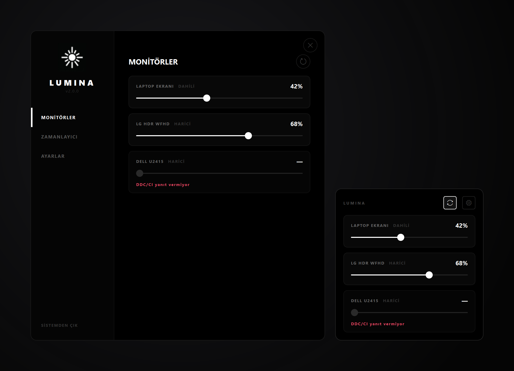
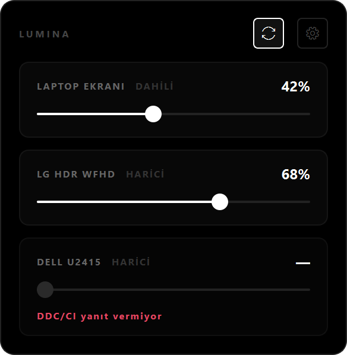
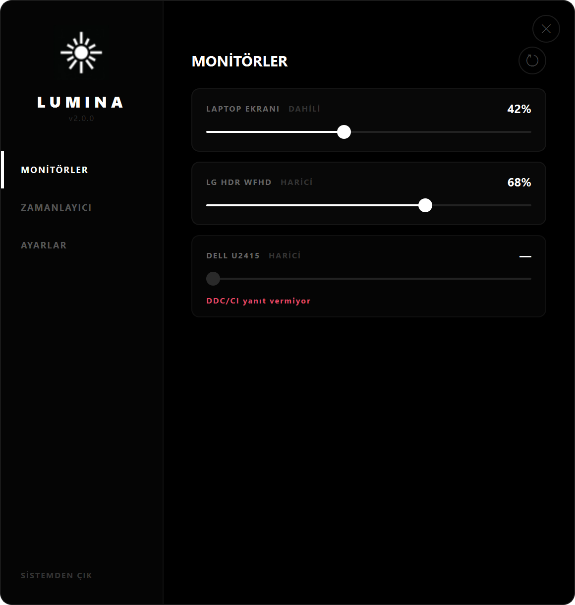
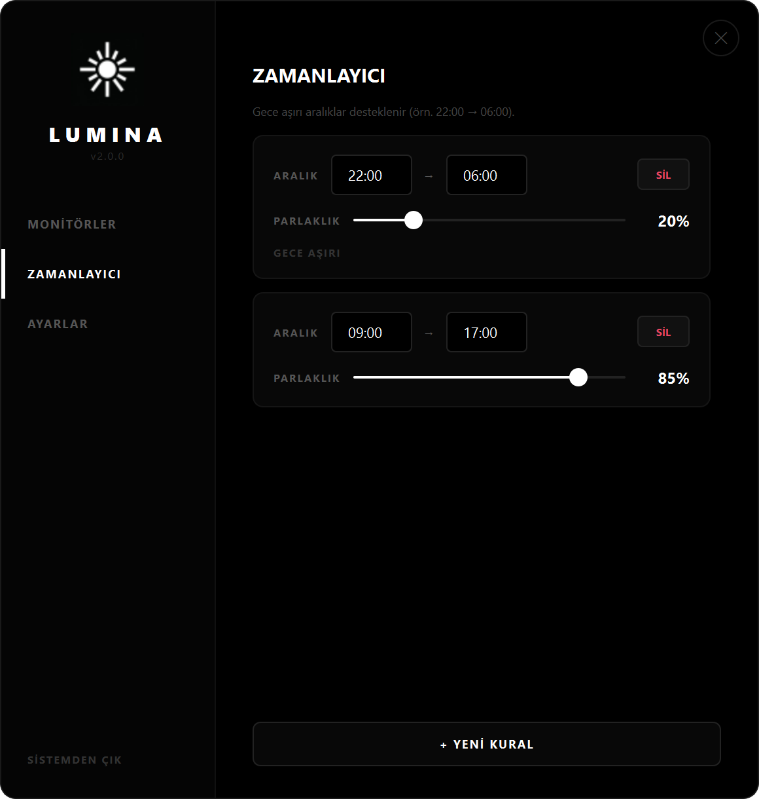
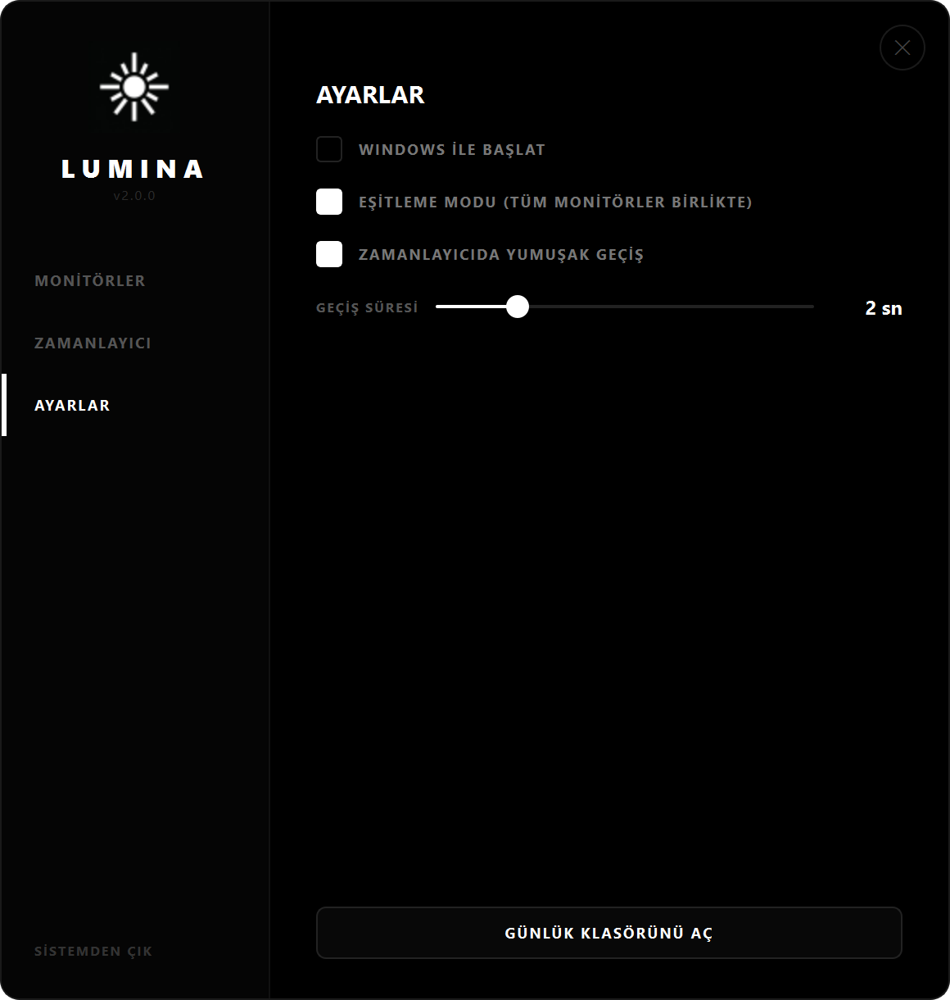

<div align="center">


# LUMINA

**Windows'ta her ekranın parlaklığı — laptop paneli ve DDC/CI monitörler, bildirim alanındaki tek slider setinden.**

[](#kurulum)
[](#geliştirme)
[](#mimari)
[](LICENSE)

[English README](README.md)



</div>

---

Harici monitörlerin parlaklık tuşu yoktur. Windows yalnızca dahili panel için
slider gösterir; masadaki monitör ya kendi OSD düğmelerinden ayarlanır ya da hiç
ayarlanmaz.

LUMINA ikisini de aynı yerden sürer. Laptop paneli WMI üzerinden, harici
monitörler ekran kablosu üzerinden DDC/CI ile — ve hiçbiri başka bir programı
çalıştırmaz.

## Özellikler

<table>
<tr>
<td width="58%" valign="top">

**Hepsi tek slider setinde.** Dahili ve harici monitörler yan yana. DDC/CI'ye
yanıt vermeyen monitör bunu açıkça söyler — uydurma bir değere sessizce
düşmez.

**Tepsi paneli.** Bildirim alanı ikonuna tek sol tık, slider'lar imlecin altında.
Farenin bulunduğu ekranın içinde kalacak şekilde konumlanır; görev çubuğu
yukarıdaysa imlecin altına açılır.

**Eşitleme modu.** Tek slider tüm monitörleri birlikte hareket ettirir.

**Zamanlayıcı.** Saat aralığı + hedef parlaklık. `22:00 → 06:00` gibi gece aşırı
aralıklar dahil.

**Yumuşak geçiş.** Zamanlayıcı tetiklendiğinde ani zıplama yerine ayarlanabilir
sürede rampa. Slider'a dokunmak çalışan rampayı iptal eder.

**Tak/çıkar algılama.** Ekran taktığında veya çıkardığında liste kendini günceller.

**Windows ile başlar.** Doğrudan bildirim alanına, pencere parlaması olmadan.

</td>
<td width="42%" valign="top">



</td>
</tr>
</table>

### Ekranlar

| Monitörler | Zamanlayıcı | Ayarlar |
|---|---|---|
|  |  |  |
| Her ekran, anlık yüzde ve sürülemeyen monitör için net gerekçe. | Gece aşırı aralıklar işaretlenir. Kurallar düzenledikçe kaydedilir. | Otomatik başlatma, eşitleme, geçiş süresi ve günlük klasörü kısayolu. |

## Kurulum

[Releases](../../releases/latest) sayfasından `LuminaSetup-<sürüm>.exe` indir ve
çalıştır.

- Yönetici hakkı gerekmez. `%LOCALAPPDATA%\Programs\Lumina` altına kullanıcı
  bazlı kurar.
- Python kurulu olması gerekmez — runtime paket içinde.
- 19.9 MB installer, kurulu hali ~62 MB.

> **SmartScreen.** Installer imzasız olduğu için Windows ilk çalıştırmada uyarır:
> **Daha fazla bilgi → Yine de çalıştır**. Kod imzalama sertifikası yıllık birkaç
> yüz dolar; alınırsa `build.ps1` içinde `signtool` adımı için yer hazır.

Kaldırma normal şekilde Ayarlar → Uygulamalar'dan. `config.json` yerinde kalır;
tamamen silmek için `%APPDATA%\Lumina` klasörünü sil.

## Neden hızlı

Bu uygulamanın önceki sürümü her işlem için iki harici program çağırıyordu:
harici monitörler için `ControlMyMonitor.exe`, laptop paneli için
`powershell.exe`. Her slider tik'inde bir process açılması, performans
hikâyesinin tamamı.

LUMINA o programların sardığı Windows API'lerini doğrudan çağırıyor. Aynı
makinede ölçüldü (Intel laptop paneli + DisplayPort üzerinden LG UltraWide):

| İşlem | Subprocess ile | Doğrudan API | |
|---|--:|--:|--:|
| Tam monitör taraması | 8000 ms | **135 ms** | 59× |
| Harici monitör oku | 7840 ms | **62 ms** | 126× |
| Harici monitör yaz | 170 ms | **60 ms** | 2.8× |
| Dahili panel oku | 1183 ms | **4 ms** | 296× |
| Dahili panel yaz | 1200 ms | **7 ms** | 171× |

Harici yazmadaki 60 ms taban DDC/CI I²C veri yolunun kendisi — hiçbir yazılım
altına inemez. Yazılımın düzeltebileceği şey kuyruk: bir yazma uçarken gelen
yeni slider değerleri bekleyenin **üstüne yazılır**, arkasına dizilmez. Böylece
sürüklemeyi bıraktığın değer uygulanır, oraya giderken izlediğin yol tekrar
oynatılmaz.

Kendi donanımında ölç:

```powershell
.venv\Scripts\python.exe tools\smoke_core.py
```

Çalışma maliyeti: **927 ms** soğuk açılış, **413 ms** sıcak, boşta **%0.00** CPU,
~72 MB çalışma kümesi (~34 MB özel bellek).

## Mimari

| Konu | Yöntem |
|---|---|
| Harici monitörler | `dxva2.dll` — `GetMonitorBrightness` / `SetMonitorBrightness`, diğer VCP kodları için `SetVCPFeature` |
| Dahili panel | COM üzerinden `WmiMonitorBrightnessMethods` |
| Ekran listeleme | `EnumDisplayMonitors` + `EnumDisplayDevices` |
| Monitör isimleri | Registry'deki EDID `0xFC` tanımlayıcısı — kartta `Generic PnP Monitor` değil `LG HDR WFHD` yazar |
| Dahili/harici ayrımı | Cihaz arayüz yolu ve WMI `InstanceName`, ikisi de PNP kimliği ve donanım örneğini taşır; normalize edilince eşleşme tahmin değil kesin olur |
| Tak/çıkar | Worker boştayken 2 saniyede bir ucuz bir ekran parmak izine bakar, değişince yeniden tarar; başarısız bir DDC/CI yazımı o monitörün handle'larını yeniden alıp tekrar dener |

UI'nin altındaki her şey tek bir worker thread'de çalışır; COM apartmanı ve
DDC/CI handle'ları da orada yaşar. GUI thread'i hiçbir zaman veri yolu
gidiş-dönüşünde bloklanmaz.

```
src/lumina/
  core/
    ddcci.py       dxva2 ctypes sarmalayıcı, monitör başına VCP aralığı
    panel.py       COM üzerinden WMI
    discovery.py   listeleme, kimlik normalizasyonu, EDID ayrıştırma
    backend.py     iki taşıma katmanı üstünde tek Monitor listesi
    service.py     worker thread + yazma birleştirme
  features/
    automation.py  kural eşleştirme ve fade rampaları
    autostart.py   HKCU\...\Run
  ui/
    main_window.py  quick_panel.py  widgets.py  icons.py
  resources/       theme.qss (tüm stiller), lumina.png, lumina.ico
  app.py           güncel monitör setini bilen tek yer
build/             lumina.spec, installer.iss, version_info.txt
tools/             smoke_core.py, preview.py, measure_startup.py
```

Kullanıcı verisi:

- Ayarlar — `%APPDATA%\Lumina\config.json`, atomik yazılır
- Günlükler — `%LOCALAPPDATA%\Lumina\logs\lumina.log`, döner, 512 KB × 3

## Geliştirme

```powershell
py -m venv .venv
.venv\Scripts\python.exe -m pip install -r requirements-dev.txt
.venv\Scripts\python.exe run_lumina.py --debug
```

```powershell
.venv\Scripts\python.exe -m pytest tests -q      # 39 test, donanım gerekmez
.venv\Scripts\python.exe tools\smoke_core.py     # gerçek monitörler, gecikme raporu
.venv\Scripts\python.exe tools\preview.py        # docs/images'ı yeniden üret
.venv\Scripts\python.exe tools\measure_startup.py
```

Testler şunları kapsıyor: kural eşleştirici (gece aşırı sarma dahil), 0-100
olmayan aralıklarda VCP yüzde ölçekleme, kimlik normalizasyonu, EDID ayrıştırma,
config gidiş-dönüşü, yavaş veri yolu simülasyonuna karşı yazma birleştirme ve
sahte backend ile uçtan uca UI→backend kablolaması.

### Derleme

```powershell
.\build.ps1               # test, sonra exe, sonra installer
.\build.ps1 -ExeOnly      # PyInstaller'dan sonra dur
.\build.ps1 -SkipTests
```

Çıktı: `build\output\LuminaSetup-<sürüm>.exe`. Inno Setup kurulu değilse
`build.ps1` winget ile getirir.

PyInstaller `onedir` modunda çalışır. `onefile` her açılışta tüm paketi
`%TEMP%`'e açıyordu; eski derlemenin yavaş hissettirmesinin başlıca sebebi buydu.
Spec ayrıca hook'un ikili bağımlılık olarak çektiği Qt kütüphanelerini atar —
QML runtime, yazılımsal OpenGL rasterizer, PDF modülü ve OpenSSL — paketi
114 MB'tan 61 MB'a indirir.

## Sorun giderme

**Monitörde "DDC/CI yanıt vermiyor" yazıyor.** Ekran veri kanalında yanıt
vermiyor. OSD menüsünde DDC/CI seçeneğine bak — bazı modellerde kapalı gelir.
USB-C dock'lar, KVM switch'ler ve bazı HDMI adaptörleri de kanalı düşürür.
Laptop panelleri DDC/CI'ye hiçbir zaman yanıt vermez; onlar WMI ile sürülür ve
`DAHİLİ` etiketi taşır.

**Laptop paneli listede yok.** Bazı masaüstü GPU'lar ve sanal ekranlar
`WmiMonitorBrightness` örneği sunmaz. `--debug` ile çalıştırıp günlüğe bak.

**Parlaklık değiştirdikten sonra geri zıplıyor.** Üretici yazılımı (Dell Display
Manager, LG OnScreen Control, bazı oyun araçları) aynı VCP koduna yazıyor olabilir.

Günlükler: **Ayarlar → GÜNLÜK KLASÖRÜNÜ AÇ** veya `%LOCALAPPDATA%\Lumina\logs`.

## Katkı

Issue ve pull request'ler açık. Faydalı notlar:

- Arayüz metinleri şu an sadece Türkçe. Yerelleştirme iyi bir ilk katkı olur —
  metinler `src/lumina/ui/` içinde satır içi.
- Parlaklık mantığına dokunan her şeye `tests/` altında test lazım; donanım
  katmanı bunun yerine `tools/smoke_core.py` ile kapsanıyor.
- PR açmadan önce `pytest` çalıştır; `build.ps1` kırmızı testte derlemeyi reddeder.

## Lisans

Bu projenin kendi kodu [MIT](LICENSE).

Dağıtılan derlemeler kendi lisanslarıyla üçüncü taraf bileşenler içerir — en
önemlisi PySide6 aracılığıyla LGPL v3 altındaki Qt. Bkz.
[THIRD-PARTY-NOTICES.md](THIRD-PARTY-NOTICES.md).
